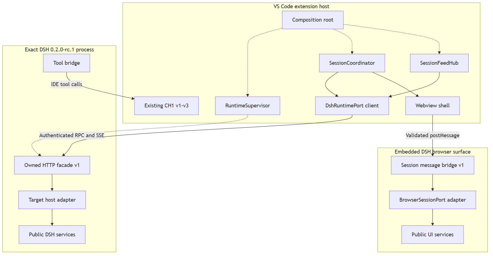

# 1.2.0 架构、接口与抽象约定

状态：**契约 v1 已实施，2026-09-30 M1 映射修订已合入；候选已生成，验收仍有明确缺口。** 目标仅 DSH `0.2.0-rc.1` / `4878cdabd87d4041bdaff61d04c966883b9fd07a`。实现证据见 [契约报告](HANDOFF-1.2.0-CONTRACTS.md)，发布状态见 [验收报告](HANDOFF-1.2.0-VALIDATION.md)。

后续完善入口：[完整 IDE 体验计划](PLAN-FULL-IDE-EXPERIENCE.md)、[VS Code profile 与插件契约](PLAN-VSCODE-PROFILE-PLUGIN-CONTRACTS.md)。后续允许通过插件扩展 DSH UI 和服务，并由 VS Code 设置控制专用 profile/插件开关；这些是待实施范围，不追溯改变本文 v1 的完成状态。

本文定义扩展自己拥有的接口，不把它们声称为 DSH 官方 API。上游证据见 [实施计划第 3、11 节](PLAN-1.2.0-DSH-0.2.0-rc.1.md)。接口冲突以本文为准；阶段和发布验收以实施计划为准。

M1 负责验证、填充上游映射，不能让各 worker 自定消费者接口。需要改约时，由主集成人记录原因，同时修改本文、schema、两端实现、契约测试和调用方；破坏 wire 兼容性的改动升级协议版本。

## 1. 架构决策

| 决策 | 约定 |
|---|---|
| A-01 | 保留 VS Code 扩展和内置 DSH 插件两个部署单元；不另造守护进程，不重写完整 DSH UI |
| A-02 | 扩展 domain 只认识本文 ports、值对象和错误；不读 DSH ctx、私有字段、DOM 或原始上游事件 |
| A-03 | 目标版本默认只走**插件实现的 `/api/vscode/v1` facade**，映射 DSH 公开服务；本轮不同时实现 native remote 客户端 |
| A-04 | 旧 `/api/session.*` 等仅属于 legacy adapter；一次 runtime lease 只选择一个 adapter，禁止双路 prompt/follow |
| A-05 | CH1 v1–v3 保持 DSH 工具 → VS Code 调用；新 facade 是 VS Code → DSH 的独立通道，不混用版本号 |
| A-06 | 新 session 消息桥管理 surface、目标与插入 ticket；已有 clipboard/editor-link bridge 保留，不通过 DOM 猜当前会话 |
| A-07 | 每窗口一个 RuntimeSupervisor、SessionCoordinator、SessionFeedHub；每 surface 一个 BrowserSessionAdapter；禁止跨窗口 singleton |
| A-08 | 不迁移全仓 TypeScript；下文 TS 仅为接口记法，实现延续 CommonJS / 集成包 ESM 与 JSDoc |



[图源](planning/1.2.0/architecture.mmd)。实线是调用/数据通道，虚线是装配或生命周期管理；返回消息不改变依赖方向。

## 2. 模块边界与文件归属

新增路径是约定落点；只改对应入口接线，不搬动无关代码。

| 模块 | 文件 | 唯一职责 / 禁止事项 |
|---|---|---|
| Composition root | `src/extension.js` | activate/deactivate、DI、命令注册；不再增加上游字段判断或后台循环 |
| RuntimeSupervisor | 新 `src/runtime/supervisor.js`、`identity.js`、`compatibility.js` | 协调现有 resolver/serverManager，独占进程/鉴权/重试；不持有当前 UI 会话 |
| Runtime transport | 新 `src/runtime/client.js` | HTTP facade、认证、schema、请求取消；不自动重放修改，不管理 UI |
| SessionCoordinator | 新 `src/session/coordinator.js` | workspace 绑定、surface 状态、导航/附件事务；不解析 SSE |
| Browser port proxy | 新 `src/session/browserProxy.js` | 在 extension host 实现 BrowserSessionPort，调用已验证的 webview 消息桥；不直接访问 iframe 服务 |
| SessionFeedHub | 新 `src/session/feedHub.js` | 共享 follow、重连、引用计数、有界投递；不提交 prompt |
| Transcript projector | 新 `src/session/transcript.js` | 纯函数处理 snapshot/durable/assistant stream；不创建连接 |
| Change projector | 现有 `src/editEventProjector.js` | 消费规范事件/观察证据、交 tracker；目标路径不再自建重连循环 |
| Host facade | 新集成 `lib/runtimeFacade.js` | 路由、认证、限额、schema、错误信封；不散布 ctx 调用 |
| Target host adapter | 新集成 `lib/adapters/dsh020rc1.js` | 唯一允许依赖目标版本 host 服务/事件结构的位置 |
| Legacy adapter | 现有 `lib/compatSessionRoutes.js` 及 legacy wiring | 保留旧路径，目标版本不调用 |
| Browser adapter | 集成 `lib/client.dsh020rc1.js` | 唯一允许访问目标版 browser 服务的位置；导航/观测/retain/输入 |
| Browser bridge | 集成 `lib/client.js`、`lib/client.sessionBridge.js` | 监听、验证、路由、清理；不读私有 current/fiber/selection |
| Contracts | 新集成 `contracts/runtime-v1.json`、`contracts/session-bridge-v1.json`；扩展 `src/protocol/runtime.js` | schema/常量/验证单一规范；两端使用同一合法/非法 fixtures |

Contracts 放内置包，保证同一份定义随它部署；扩展从固定路径读取 JSON。浏览器校验器可手写，但须跑共享 fixtures，不能自定信封。不为此新增运行时 npm 依赖或全面构建链。新增集成文件/schema 全部加入 `INTEGRATION_FILES`。

M1 落点修订：上游 module loader 的 `require.async` 只装载同包平铺 `client.*.js`，因此客户端两个新文件使用上述平铺名称。公共校验实现为 `contracts/validate.cjs`，Node 两端共用；它与两个 JSON schema 一并同步。

保留 sessionNavigation、dshChatClient、exportsFace、chatParticipant 现有对外签名，用 wrapper 转调新 ports，旧导出错误码在边界映射。依赖只能是 composition → services → ports/纯 domain；transport/adapters 实现 ports。domain 不 import vscode、网络、child_process 或 DSH 包。

## 3. 值对象与统一错误

ID 不透明，不用前缀推导关系；路径不充当会话身份。空值和 unknown 分开。

```ts
type RuntimeInstanceId = string; // 每次实际 server 生命周期唯一
type SurfaceId = string;         // sidebar 或一个额外 panel
type SessionId = string;
type WorkspaceId = string;
type RequestId = string;         // 非空 <=100，沿用安全字符约束
type DurableSeq = string;        // 持久源序号的规范字符串；不是 HTTP 恢复游标
type Json = null | boolean | number | string | Json[] | { [key: string]: Json };
interface OperationContext {
  requestId: RequestId; signal: AbortSignal;
  timeoutMs?: number; // 只能缩短该操作默认 deadline
}
interface RuntimeIdentity {
  runtimeVersion: string; integrationVersion: string;
  adapterId: 'dsh-0.2.0-rc.1' | 'legacy-0.1.2-rc.1';
  executablePath: string; entrypoint: string; packageRoot: string;
  home: string; profile: string; source: 'managed' | 'local' | 'command';
}
interface PortError {
  code: 'INVALID_ARGUMENT' | 'UNAUTHENTICATED' | 'FORBIDDEN'
    | 'UNSUPPORTED_RUNTIME' | 'CAPABILITY_UNAVAILABLE' | 'NOT_READY'
    | 'NOT_FOUND' | 'CONFLICT' | 'STALE_TARGET' | 'CANCELLED'
    | 'TIMEOUT' | 'TRANSPORT_LOST' | 'OUTCOME_UNKNOWN'
    | 'BACKPRESSURE' | 'RESYNC_REQUIRED' | 'PROTOCOL_MISMATCH' | 'INTERNAL';
  message: string; // 已脱敏，可展示
  retryable: boolean; // 可重新决策，不授权自动重放修改
  effect: 'none' | 'unknown'; // 失败时能否排除已经生效
}
```

本地 Promise 成功 resolve 数据，失败 reject 带上述字段的 Error；禁止同时用 null/false/吞错表示同一失败。wire 用第 6 节信封。已发出的修改无法确认结果时返回 OUTCOME_UNKNOWN/effect:unknown；取消等待不证明远端未执行。

Identity 冻结；PID、endpoint、secret、AbortController 属于 supervisor 私有实例记录，不向值对象或诊断泄露。日志不包含原始 ctx、密钥、完整会话正文。

## 4. 运行时与 host ports

```ts
interface Capability {
  state: 'available' | 'unavailable' | 'unverified';
  reason?: string; // 非 available 必填
}
interface CapabilityReport {
  protocolVersion: 1; adapterId: RuntimeIdentity['adapterId'];
  runtimeVersion: string; integrationVersion: string;
  runtimeInstanceId: RuntimeInstanceId;
  reconnectMode: 'snapshot-reconcile';
  features: Record<'workspaces' | 'sessions' | 'prompt' | 'follow'
    | 'cancelSession' | 'toolObservation' | 'lmRoute' | 'fim', Capability>;
}
interface WorkspaceSummary { id: WorkspaceId; rootPath: string; name: string | null; }
interface SessionSummary {
  id: SessionId; workspaceId: WorkspaceId | null;
  title: string | null; updatedAt: string | null; // UTC ISO；缺失不伪造
}
type PromptPart = { kind: 'text'; text: string }
  | { kind: 'file'; uri: string; label: string | null }
  | { kind: 'image'; uri: string; mediaType: string | null };
interface PromptInput {
  sessionId: SessionId; content: PromptPart[];
  mode: 'queue' | 'steer'; clientRequestId: RequestId;
}
interface DshRuntimePort {
  capabilities(op: OperationContext): Promise<CapabilityReport>;
  listWorkspaces(op: OperationContext): Promise<WorkspaceSummary[]>;
  ensureWorkspace(rootPath: string, op: OperationContext): Promise<WorkspaceSummary>;
  listSessions(workspaceId: WorkspaceId | null, op: OperationContext): Promise<SessionSummary[]>;
  createSession(workspaceId: WorkspaceId, op: OperationContext): Promise<SessionSummary>;
  renameSession(id: SessionId, title: string, op: OperationContext): Promise<void>;
  submitPrompt(input: PromptInput, op: OperationContext):
    Promise<{ admission: 'accepted'; clientRequestId: RequestId }>;
  cancelSession(id: SessionId, op: OperationContext): Promise<{ admission: 'accepted' }>;
  openFeed(id: SessionId, op: OperationContext): Promise<SessionFeed>;
}
interface SessionFeed {
  events: AsyncIterable<SessionUpdate>;
  close(): Promise<void>; // 幂等；return/abort/finally 走相同清理
}
interface RuntimeLease {
  instanceId: RuntimeInstanceId; identity: Readonly<RuntimeIdentity>;
  owned: boolean; api: DshRuntimePort;
}
interface RuntimeSupervisor {
  ensure(selection: RuntimeIdentity, op: OperationContext): Promise<RuntimeLease>;
  restart(op: OperationContext): Promise<RuntimeLease>; // borrowed → FORBIDDEN
  stop(op: OperationContext): Promise<void>; // 只停止自管 child
  dispose(): Promise<void>; // obey closePolicy
}
```

selection 必须已解析/验证，不接受 latest。相同 selection 的并发 ensure 共享一次启动，不同 selection 串行切换。ready 必须通过版本、授权健康和 facade capabilities；root HTTP 200 不足。instanceId 由启动方生成，经私有 env 交 facade，响应必须匹配。

ensureWorkspace 在实例内按规范化 root 串行 lookup/create，结果不明则重新查询，不承诺跨实例原子幂等。createSession/submitPrompt/cancelSession 禁止自动重试。clientRequestId 是关联 ID，**不是已证明的 DSH 幂等键**；从 host 到 DSH 保持同一 ID，不另发 prompt。

submitPrompt accepted 只代表入队。cancelSession 作用于整个 session 的活动 turn，目标版本保留 inbox；不代表“取消单条 prompt”或“清空队列”。OperationContext.signal 只取消本次等待/观察，不能隐式调用 cancelSession。

现有 prompt wrapper 保留 `content:string|parts` 和 `mode` 签名；string 转为一个 text part，缺省 mode 转为 queue，steer 必须保留语义。M1 列出已有 parts 到 PromptPart 再到上游的逐项映射；不把未知对象直通、不丢弃附件、不把 steer 静默改为 queue。无法映射的输入返回 INVALID_ARGUMENT 或 CAPABILITY_UNAVAILABLE；既有承诺格式缺失时按兼容性缺口阻断相应验收，不能仅靠显式报错宣称兼容。uri 不授权扩展任意读取文件或下载远程资源，仍遵守现有附件/工作区授权。

openFeed 的 deadline 仅覆盖建连、验证并取得首个有效 snapshot；成功 resolve 前缓存该 snapshot，events 首次迭代必须先交付它，不能漏帧。此后停用建连 deadline，改用 heartbeat/stall；调用方 signal、close、iterator.return 控制整个 feed 生命周期，正常长会话不能被 RPC 30 秒定时器反复切断。events 是单消费者异步迭代流，多消费者只能通过 hub。

## 5. 事件抽象与恢复

### 5.1 身份和 payload

| 身份 | 范围 | 用途 |
|---|---|---|
| runtimeInstanceId + streamEpoch + deliverySeq | 一次 facade 连接 | 投递顺序/迟到检测，不作持久恢复游标 |
| sessionId + durableSeq | 持久历史 | 去重；runtime 重启不改变源身份 |
| runtimeInstanceId + sessionId + attemptId + revision + index | 临时 assistant 流 | chunk/重试识别，不能与 durableSeq 合并 |

```ts
type ContentPart = { kind: 'text'; text: string }
  | { kind: 'file'; uri: string; label: string | null }
  | { kind: 'image'; uri: string; alt: string | null }
  | { kind: 'unsupported'; mediaType: string; label: string };
interface TranscriptRecord {
  id: string; // 稳定投影键，不是数组位置
  kind: 'user' | 'assistant' | 'tool' | 'status';
  content: ContentPart[]; clientRequestId: RequestId | null;
  tool: null | { callId: string; name: string; state: 'running' | 'succeeded' | 'failed' };
}
type RecordChange = { op: 'upsert'; record: TranscriptRecord } | { op: 'remove'; id: string };
type UpdatePayload =
  | { kind: 'snapshot'; records: TranscriptRecord[]; sourceCursor: string | null;
      hasMore: boolean; window: { maxMessages: number } }
  | { kind: 'durable'; durableSeq: DurableSeq; changes: RecordChange[] }
  | { kind: 'assistant-start'; attemptId: string; revision: number }
  | { kind: 'assistant-chunk'; attemptId: string; revision: number; index: number;
      text: string; channel: 'answer' | 'reasoning' }
  | { kind: 'assistant-end'; attemptId: string; revision: number;
      outcome: 'committed' | 'abandoned'; committedSeq: DurableSeq | null }
  | { kind: 'turn-state'; clientRequestId: RequestId | null;
      state: 'queued' | 'running' | 'completed' | 'cancelled' | 'failed' }
  | { kind: 'edit-observation'; observation: EditObservation }
  | { kind: 'resync-required'; reason: string };
type SessionUpdate = UpdatePayload & {
  runtimeInstanceId: RuntimeInstanceId; sessionId: SessionId;
  streamEpoch: string; deliverySeq: number; // 单连接从1连续增长
};
```

这是扩展归一化视图，不是上游 wire 照抄。adapter 保留人类可见 transcript 的替换/删除语义；M1 确认目标版本 human transcript 取 append-origin，模型上下文 surface replacement 不删除用户已见历史，此类事件以空 changes 推进持久水位。无法正确映射核心事件时 follow 为 unavailable，M3 阻断。不支持的内容显式占位。turn-state 只从已验证上游来源生成，attempt end、socket close 都不能推测为 turn completed；无法可靠关联请求则保留 null，不误完成另一请求。

M1 流身份修订：上游 revision 每帧增长，上游 index 也计入非文本块；两者均独立验证连续性。归一化 revision 固定为本连接首次观察 attempt 的 source revision（opening 用 baseline.revision），归一化 index 仅对 answer/reasoning 文本增量连续计数。重连用新 streamEpoch 区分，不承诺跨连接 revision 不变。VS Code 只能追加的 markdown 输出仅追加 committed durable 正文，临时增量走 progress；原生 DSH 页面仍流式显示。

M1 必须逐字段记录上游来源、转换和样本；缺失字段不填假数据，无法映射时走改约。

### 5.2 共享、取消和重连

```ts
interface TranscriptState {
  records: readonly TranscriptRecord[]; hasMore: boolean; sourceCursor: string | null;
  activeAttempts: readonly {
    attemptId: string; revision: number; nextIndex: number;
    answer: string; reasoning: string;
  }[];
  turn: null | { clientRequestId: RequestId | null;
    state: 'queued' | 'running' | 'completed' | 'cancelled' | 'failed' };
}
interface FeedBaseline {
  runtimeInstanceId: RuntimeInstanceId; sessionId: SessionId;
  streamEpoch: string; throughDeliverySeq: number; state: Readonly<TranscriptState>;
}
interface FeedSubscription { release(): void; } // 幂等
interface SessionFeedHub {
  subscribe(key: { instanceId: RuntimeInstanceId; sessionId: SessionId },
    consumer: { onBaseline(baseline: FeedBaseline): void;
      onUpdate(update: SessionUpdate): void; onError(error: PortError): void }): FeedSubscription;
  dispose(): Promise<void>;
}
// transcript.js 的纯函数，不访问连接；非法序列抛 RESYNC_REQUIRED。
function createTranscriptState(): Readonly<TranscriptState>;
function reduceSessionUpdate(state: Readonly<TranscriptState>, update: SessionUpdate):
  Readonly<TranscriptState>;
```

共享 key 固定 `(runtimeInstanceId,sessionId,projectionVersion=1)`。chat/changes 等消费者独立 release；最后一个 release 关闭 feed。单个消费者不拥有底层 abort，也不停止 DSH turn。

hub 原子注册消费者并交付**当前投影状态** onBaseline，包含已应用 durable 变化和进行中 attempt 的完整 answer/reasoning/nextIndex；随后只交付该 epoch 中大于 throughDeliverySeq 的 update，不能漏掉注册间隙。未有基线则等待；重连每个消费者先收到新 onBaseline，再收新 epoch 增量。onBaseline 是 hub 本地通知，不伪造成带新 deliverySeq 的上游 snapshot；历史 EditObservation 不随基线重新执行。consumer 回调同步有界，抛错隔离并释放该消费者，不影响其他消费者。

只有 hub 管重连，transport/projector/UI 不再叠加重连循环。目标 follow 没有已证实的 afterSeq/sinceSeq/resumeToken，因此固定 **snapshot-reconcile**：新 epoch → 验证 opening snapshot → 替换当前活动窗口 records、清理旧临时流 → 后续增量。snapshot 是有限窗口，hasMore 保留；TranscriptState 只管理这个窗口，消费者另存的旧历史不能因不在新 snapshot 中而被当作删除。sourceCursor 只作水位证据，不能发 Last-Event-ID 或请求增量回放。

溢出、帧缺口或非法替换时发送 resync-required（若还能发送）并关闭，由 hub 重取基线；不能静默丢弃持久事件。临时 chunk 缺失也需重建该 attempt，不能跳过后继续错误拼接。投影结果须不重复，但不承诺跨连接 exactly-once 投递。

## 6. 插件自有 HTTP facade v1

这些路由由插件注册在 DSH webServer，不是上游内置 API。

| 路由 | 信封 | 约定 |
|---|---|---|
| GET `/api/vscode/v1/capabilities` | CapabilityReport | 每次启动核对协议/runtime/integration/instance；未验证不能报 available |
| POST `/api/vscode/v1/rpc` | RpcRequest/RpcResponse | 方法 allow-list，无任意 ctx/method 执行 |
| GET `/api/vscode/v1/events?sessionId=...` | SSE `event:update`，data=SessionUpdate | query 仅编码 sessionId，无 cursor；开流前验证权限/实体 |

```ts
interface RpcRequest { protocolVersion: 1; requestId: RequestId; method: string; params: Json; }
type RpcResponse = { protocolVersion: 1; requestId: RequestId; ok: true; value: Json }
  | { protocolVersion: 1; requestId: RequestId | null; ok: false; error: PortError };
```

| method | params | value |
|---|---|---|
| workspace.list | `{}` | WorkspaceSummary[] |
| workspace.ensure | `{rootPath}` | WorkspaceSummary |
| session.list | `{workspaceId: string 或 null}` | SessionSummary[] |
| session.create | `{workspaceId}` | SessionSummary |
| session.rename | `{sessionId,title}` | null |
| session.prompt | `{sessionId,content:PromptPart[],mode:'queue'或'steer',clientRequestId}` | `{admission:'accepted',clientRequestId}` |
| session.cancel | `{sessionId}` | `{admission:'accepted'}` |

Json 只是信封基础类型；每个 method 必须按表建立封闭 schema，拒绝额外字段。runtime-v1.json 定义各方法、事件 union、能力和错误，不允许把任意 Json 透传 DSH。只在畸形请求无可信 ID 时使用 requestId:null，不回显原始输入。

认证：每次自管启动生成独立 bearer，私有 env `DSH_VSCODE_API_TOKEN` 交 facade；instance env 为 `DSH_VSCODE_RUNTIME_INSTANCE_ID`。token 不复用 CH1 token，不进 URL/日志/页面/webview state。facade 在读 body、分配 stream、调用服务前验证 Authorization，常量时间比较；不开放 CORS，不接受 cookie-only，拒绝带浏览器 Origin 的请求。host HTTP 不带 Origin；若上游还需要启动 cookie，transport 私下同时处理，不关闭上游鉴权。

borrowed server 仅在具备可信 token/instance 握手时启用 facade，不读取他人日志 token，不注入或重启借用实例。无 facade 可保留浏览器打开功能，集成功能报告 CAPABILITY_UNAVAILABLE；不能以 root 200 判定集成可复用。

状态码：400 参数/格式，401 认证，403 权限/Origin，404 路由/实体，409 冲突，413 限额，429 背压，503 未就绪，504 deadline，500 意外异常；RPC 失败保持统一信封。开流后失败发送 `event:error`、data=PortError 再关闭；坏连接直接清理。SSE 心跳用注释帧，transport 识别 liveness，业务不接收心跳。连接关闭须 abort 上游跟随并 iterator.return；请求超时不 cancelSession。

## 7. BrowserSessionPort 与消息桥

### 7.0 SessionCoordinator 入口

```ts
interface SessionCoordinator {
  registerSurface(input: { surfaceId: SurfaceId; surfaceEpoch: number;
    lease: RuntimeLease; browser: BrowserSessionPort }): () => void;
  bindWorkspace(surfaceId: SurfaceId, rootPath: string,
    op: OperationContext): Promise<WorkspaceSummary>;
  getTarget(surfaceId: SurfaceId): VisibleTarget;
  navigate(surfaceId: SurfaceId, sessionId: SessionId,
    op: OperationContext): Promise<VisibleTarget>;
  insertAttachment(surfaceId: SurfaceId,
    prepare: (signal: AbortSignal) => Promise<string>,
    op: OperationContext): Promise<{ inserted: true }>;
  dispose(): Promise<void>;
}
```

registerSurface 返回幂等 unregister；同 surface/epoch 重复注册为 CONFLICT，新 epoch 注册必须先使旧事务失效并清理旧 proxy。root 注入的 browser 是 host proxy，不是在扩展进程里访问 DSH browser ctx。lease 失效时撤销该 surface 的事务；新实例必须重新握手。getTarget 返回带 surface 身份的只读镜像，未注册 surface 为 NOT_FOUND。

bindWorkspace 只调用 ensureWorkspace 并更新已有 workspaceBinding；不因焦点切换创建会话、提交 prompt 或导航。navigate 要验证 session 属于该 lease 和明确选定的 workspace，再委托 browser 并等待可信目标确认。现有发送/新建命令显式决定何时 createSession；不能用全局 current 解决 sidebar、panel、exports 的目标。insertAttachment 先 capture，再执行 prepare，最后 commit；失败、取消、超时和 unregister 均在 finally 取消未终结 ticket，generation 变化则拒绝落地。

### 7.1 目标与插入事务

```ts
type VisibleTarget = {
  surfaceId: SurfaceId; surfaceEpoch: number; selectionGeneration: number;
} & ({ state: 'known'; sessionId: SessionId }
  | { state: 'none' } | { state: 'unknown'; reason: string });
interface InsertionTicket {
  ticketId: string; surfaceId: SurfaceId; surfaceEpoch: number;
  selectionGeneration: number; sessionId: SessionId; expiresAt: number; // Unix ms
}
interface BrowserSessionPort {
  getTarget(): VisibleTarget;
  observeTarget(listener: (target: VisibleTarget) => void): () => void;
  navigate(sessionId: SessionId, op: OperationContext): Promise<VisibleTarget>;
  captureInsertion(expected: VisibleTarget, op: OperationContext): Promise<InsertionTicket>;
  commitInsertion(ticketId: string, text: string, op: OperationContext): Promise<{ inserted: true }>;
  cancelInsertion(ticketId: string): void;
  dispose(): void;
}
```

Browser adapter 是目标和 ticket 权威，coordinator 只持镜像。dsh_session query 是初始导航请求，不是永久当前会话。每次实际 A→B→A 都增加 selectionGeneration；iframe 重建增加 surfaceEpoch。没有可靠公开观测就 unknown，不能猜成 known。

navigate 仅在可靠观测 known 且目标匹配时 resolve；调用 openSession 返回不等于 UI 到位。公开观测尚待 M1 验证，不读 uiWorkspace 私有 selection/mainReference。受控导航/显式选择替代方案也必须证明手动切换不会导致过期目标，否则发布阻断。

附件顺序固定：capture 目标/插入点 → 异步准备文本 → 按 ticket commit。上游 opaque insertion token 和 retain handle 留在 browser adapter 内存，不穿 wire。提交复核 surfaceEpoch/selectionGeneration/sessionId/过期/draft revision；安全插入依赖经验证的上游 revision 机制，不能以整段 setDraft 覆盖期间新输入。不匹配返回 STALE_TARGET/CONFLICT，草稿不变。

capture 成功独占一次 retain，commit/cancel/过期/dispose 终止时释放一次。unknown 返回 CAPABILITY_UNAVAILABLE 并引导明确选择，none 返回 NOT_READY。安全降级**不等于默认附件功能验收通过**，A07 仍为发布门槛。

### 7.2 新 session bridge v1

新 channel=`dsh-vscode-session`，version=1。原 interaction v1 保持；thread v1 仅供 legacy，目标版附件走 ticket 流。CH1 不变号。

```ts
interface SurfaceEnvelope {
  channel: 'dsh-vscode-session'; version: 1;
  surfaceId: SurfaceId; surfaceEpoch: number;
  type: 'hello-init' | 'hello-ack' | 'request' | 'result' | 'targetChanged';
}
// request = envelope + {requestId,method,params}
// result = envelope + {requestId,ok:true,value} 或 {requestId,ok:false,error}
// targetChanged = envelope + {target:VisibleTarget}
// hello-init = envelope + {nonce:string}，nonce 是 shell 生成的 32 位小写十六进制随机数
```

| method | params | result value |
|---|---|---|
| target.get | `{}` | VisibleTarget |
| session.navigate | `{sessionId}` | VisibleTarget |
| insertion.capture | `{expected:VisibleTarget}` | InsertionTicket |
| insertion.commit | `{ticketId,text}` | `{inserted:true}` |
| insertion.cancel | `{ticketId}` | null |
| request.cancel | `{targetRequestId}` | null |

methods 仅上表，按封闭 schema 在 session-bridge-v1.json 固定。signal 不可序列化；host deadline/abort 发送 request.cancel 并停止等待。接收方尽力 abort 对应在途工作并释放尚未交出的 capture；取消不能撤销已发生导航/插入，更不能调用 DSH cancelSession。已发 commit 未知结果按 OUTCOME_UNKNOWN 处理，只能在同 epoch/回执期限内用原 ticket 查询式重试，不能另 capture 重插。

握手由 host 发起：shell 在每次 iframe load 后先分配 surfaceId/surfaceEpoch，发送 hello-init；iframe 验证 parent 来源后采用该身份，以 hello-ack 原样回显，并附 runtimeVersion、adapterId、browser capabilities（navigation/targetObservation/insertion/theme/clipboard）。ack 前不接收业务消息；host 验证匹配后才启用 proxy。hello-init 可在同 epoch 有界重发，iframe 同身份幂等 ack，不能由 iframe 自报新身份。握手总 deadline 5秒，重发间隔250ms，失败显示 NOT_READY；不重载 iframe 进入循环。

shell 检查 event.source 为 frame.contentWindow 和准确 DSH origin，iframe 检查 source===parent 和 URL 中的独立握手 nonce，首次匹配后锁定父源。shell 先把同一 hello-init 发给 extension host 分配 proxy，再发给 iframe；nonce 必填。来源与 epoch 检查不可互相替代；不信任任意 frame 提供的 surfaceId。编辑器/剪贴板继续遵守原 consent gate。

同 requestId 同 payload 的在途请求共享结果，不同 payload 返回 CONFLICT。已提交 ticket 保留有界回执，重复 commit 返回原结果不再插入；容量满时拒绝新 capture，不驱逐有效回执。surface 重建终止旧请求，以 epoch 拒绝迟到消息。

## 8. 生命周期和默认预算

| 对象 | 状态 | 约束 |
|---|---|---|
| RuntimeSupervisor | idle → resolving → preparing → starting → authenticating → ready；可 failed/lost/stopping | stop/dispose 失效旧 generation；自动失败受冷却，只有 supervisor 管重启 |
| FeedHub entry | opening → baseline → live → resync/backoff → opening；可 closed | 最后引用释放终止；dispose 后不重连，不并发 opening 两代 |
| Surface | created → handshake → ready/unknown → disposed | epoch 更新终止旧事务；隐藏且保留上下文不算重建 |
| Ticket | captured → committed/cancelled/expired | 唯一终态、release 一次；重复请求只读回执 |

工厂注入 clock/timers/fs/fetch/log/vscodeFacade，返回只读方法和幂等 disposer；禁止 import 即启动网络/定时器。dispose 顺序：停接命令 → 取消 surfaces/tickets → 释放 feeds → 按策略处理自管 runtime → 关 bridges/log；实际进程退出前保留其清理所需桥。所有异步落地检查 generation，不能只依赖 signal。

工厂名字与最小依赖固定如下；依赖以对象参数注入，测试可替换实现，不能从模块级 singleton 偷取。clock 提供 now()，timers 提供 setTimeout/clearTimeout；业务模块不自行读取 process.env。

| 工厂 | 注入依赖 | 返回 |
|---|---|---|
| createRuntimeSupervisor | resolver、serverManager、prepareIntegration、createClient、clock、timers、logger | RuntimeSupervisor |
| createDshRuntimeClient | endpoint、tokenProvider、expectedInstanceId、fetch、clock、timers | DshRuntimePort |
| createSessionFeedHub | openFeed(key,op)、createRequestId、clock、timers、limits、logger | SessionFeedHub |
| createSessionCoordinator | workspaceBinding、createRequestId、clock、timers、logger | SessionCoordinator |
| createBrowserSessionProxy | surfaceIdentity、postMessage、subscribeMessages、clock、timers | BrowserSessionPort |
| createBrowserSessionAdapter | ctx、surfaceIdentity、clock、timers | BrowserSessionPort |

root 用 supervisor 的当前 lease 实现 hub.openFeed，校验 key.instanceId 后调用 lease.api.openFeed；不能在过期 key 上偷偷 ensure 新 runtime。ctx 只注入集成包 adapter，其他服务不依赖它。logger 只收脱敏结构字段；测试可观测的计数包括 activeFeeds、retains、tickets、pendingRequests、reconnectTimers。

| 默认限额 | 值与语义 |
|---|---|
| capability / RPC deadline | 5秒 / 30秒；调用方可缩短，交互审批沿用现有独立机制 |
| startup / 自动冷却 | 30秒 / 30秒；显式重试可绕冷却，不能并发启动 |
| body / response / SSE单帧 | 1 MiB / 4 MiB / 1 MiB，超限拒绝，不截断 JSON |
| feed window | maxMessages=200，有限窗口，保留 hasMore |
| feed 背压 | 每连接256帧且4 MiB，含等待 socket drain 的写入；超限 resync+close |
| heartbeat / stall | 8秒 / 30秒；注释帧也更新 liveness |
| 重连 | 1/2/4/8/16/30秒，最多连续6次失败；耗尽报告错误，显式重试/新实例重置；基线后稳定60秒重置计数 |
| 共享 feeds | 每窗口32个key，超限 BACKPRESSURE；零引用立即清理 |
| hub 投影缓存 | 每key最多200条records、4MiB序列化状态；消费者获得只读状态，不保留无限事件尾部；超限明确报BACKPRESSURE并停止自动重连，避免稳定大数据引发循环 |
| ticket / 回执 | ticket 30秒、每surface32个；回执120秒、最多256项；dispose 全清 |
| watcher | 保留1.1.8的256 pending、排除优先、串行flush和Git降级 |

常量集中定义。正常目标数据超限时提交有证据的预算调整和边界测试，不无限放大。大导出维持独立有界 artifact 路径，不塞入 RPC。

## 9. 变更观察

```ts
interface EditObservation {
  observationId: string; runtimeInstanceId: RuntimeInstanceId;
  sessionId: SessionId; path: string;
  phase: 'pre-execute' | 'confirmed';
  origin: 'tool-observer' | 'session-event' | 'filesystem';
  tool: 'edit' | 'write' | null; // M1 增补，精确匹配候选与 confirmed 来源
  toolCallId: string | null; sourceDurableSeq: DurableSeq | null;
  beforeText: string | null; // 沿用snapshot大小/授权约束
}
// 仅本地关联使用，不进入 SessionUpdate 或 facade wire。
type UnattributedEditEvidence = Omit<EditObservation,
  'sessionId' | 'runtimeInstanceId' | 'origin' | 'sourceDurableSeq'> & {
  sessionId: null; runtimeInstanceId: RuntimeInstanceId | null;
  origin: 'tool-observer' | 'filesystem'; sourceDurableSeq: null;
};
type ChangeEvidence = EditObservation | UnattributedEditEvidence;
interface ChangeProjectorPort {
  observe(evidence: ChangeEvidence): void;
}
```

pre-execute 只说明尝试，先作为 attribution 候选；有已验证 tool success/文件变化证据才 confirmed。observationId 只能去重同一通知，不证明跨来源同一操作。优先 toolCallId/durable identity；path/sessionId/时间窗仅 legacy heuristic，诊断明确区分；失败/取消工具不记为成功修改。

传输入口固定，不能另开第四条通道：

1. pre-execute 沿用 CH1 **v3** 的 `vscode/dshEditObserved` 通知和既有 payload；host 接收边界补本地 observationId/runtimeInstanceId，归一化后调用 change projector 的 `observe(evidence:ChangeEvidence):void`。缺可靠 sessionId 的通知归为 UnattributedEditEvidence，经同一个 sink 保留为未归属候选，不构造假的会话身份。v1/v2 不支持该通知时报告能力缺失，不改变旧协议含义。
2. 目标 adapter 从已验证的持久工具事件生成 confirmed `SessionUpdate.kind='edit-observation'`，经原有 facade SSE → hub.onUpdate → 同一个 observe sink；不再由 change projector 私自订阅原始 session/event。内部 observation 的 runtime/session 必须与外层一致，sourceDurableSeq 指向证据；相同源与路径产生稳定 observationId，重连不重复记账。
3. 现有 watcher 在本地归一化实际文件变化证据，经相同 sink 做关联。filesystem 证明文件变了，不能独自证明是哪条工具调用；没有可靠关联时保留“来源未知”，不强行归到当前会话。

CH1 pre-execute 和 feed confirmed 不承诺全局顺序；允许确认先到，不把迟到 pre-execute 降级已确认状态。掉线不回放陈旧 pre-execute；confirmed 的持久回填通过已有 history/projector 的规范化入口去重，有限窗口之外不能凭空补证据。M1 必须核实可获得的工具事件标识和确认来源，缺失时把 toolObservation 标为未验证并阻断相关默认 Changes 验收。

## 10. 契约验收与未决映射

- K01：两端接受同一合法fixtures，拒绝错版本/额外字段/非法ID/超限；不能只测源码字符串。
- K02：三种流身份分离，有限snapshot不删窗口外历史，attempt abandon/commit不重复文本、不冒充turn completion。
- K03：取消请求/订阅不取消会话；未知admission不重发；session级cancel保留inbox语义可见。
- K04：两消费者仅一条follow，释放一方不影响另一方，最后release/dispose清理；压力下有界。
- K05：A→B→A、epoch变化、迟到附件、revision变化、重复commit均不串会话/覆盖/二次插入。
- K06：unknown target不写草稿；真实公开观测有证据；安全降级不算核心验收PASS。
- K07：错runtime/Node/instance、无/错token、浏览器Origin不能访问facade；borrowed不被停止。
- K08：VSIX、同步allow-list、client依赖与安装目录使用同版contracts/adapter，无新旧双链路。
- K09：queue/steer及已支持content parts保持语义；新消费者在生成中加入时获得完整当前基线，随后增量无缺口；正常feed持续超过30秒不断开。
- K10：CH1尝试观察与feed/文件确认证据都到同一个sink；跨通道乱序、重连、工具失败不产生成功记录或重复变更。

**未决的是上游映射，不是职责归属。** M1 必须交付公开 target observation、每个 UpdatePayload 来源、confirmed工具证据、prompt/follow/cancel payload及Node/CLI/auth实测。公开API无法实现时报告缺口与改约提案；主集成人先更新契约和验收，不能猜字段/轮询不存在的current来假装完成。

M0 基线和 M1 映射已经保存；M2–M4 主体已实现。M5/M6 的实际验收范围以验收报告为准，不能把主会话插入能力泛化为所有 DSH 内嵌 composer，不能把 unit PASS 写成安装态 PASS。
