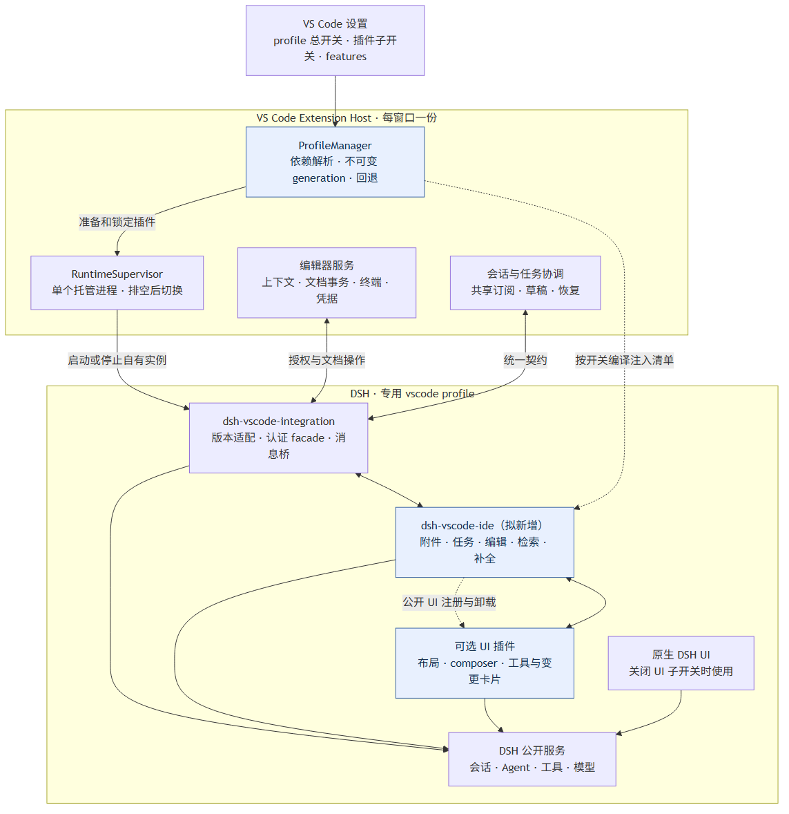

# DSH for VS Code：完整 IDE 体验实施计划

制定日期：2026-09-30。状态：**待实施的增量计划，不是完成报告**。

用户目标：完善现有全部功能，形成侧栏 Agent 编程与编辑器内 AI 编辑的完整工作流；**DSH 侧新增能力和 UI 改动均通过插件注入，维护专用 VS Code profile，并由 VS Code 设置控制该 profile 启停和各插件模块的开关**。本文的 profile 指 DSH profile，不是 VS Code 用户配置档。

当前基线是扩展 1.2.0 candidate、集成包 0.10.0、精确 DSH 0.2.0-rc.1。原候选的实现与验收事实仍以 [验收报告](HANDOFF-1.2.0-VALIDATION.md) 为准。已有 [1.2.0 架构契约](PLAN-1.2.0-ARCHITECTURE-CONTRACTS.md) 不被本文追溯改写；新增能力遵守 [插件与 profile 契约](PLAN-VSCODE-PROFILE-PLUGIN-CONTRACTS.md)。本次只交付计划，不升级运行时、不修改日常 profile、不替换已安装 VSIX。

## 1. 完成目标与范围

完成的用户旅程必须是：打开项目 → 连接已验证的运行时 → 选择模型与上下文 → 对话/编辑 → 查看执行状态 → 审阅修改 → 运行测试 → 继续修正或回退 → 关闭并恢复会话。逐项功能有代码、可发现入口、真实安装态证据和故障恢复说明，才能记为完成。

这里的“完整”覆盖第 3 节 F01–F28，而不是声称复刻其他产品所有现有或未来功能。产品体验参考不等于模型能力或服务规模承诺。云端任务集群、移动端、多人协作服务和自建模型训练不属于本次范围；远程 VS Code 环境纳入最后阶段单独认证，不冒充当前已支持。

固定原则：

1. 保留 VS Code 扩展、DSH 插件两个部署端；不用常驻外部守护进程拼接状态。
2. 编辑器文档、未保存内容、WorkspaceEdit、终端 UI、SecretStorage 属于扩展；Agent、工具策略、会话、模型调用属于 DSH。
3. DSH 已有公开能力通过 adapter 复用。缺少的能力编写自有插件；不修改官方安装包、打运行时源码补丁、访问私有 React 状态或用 DOM 猜会话。
4. 公开扩展点不足时，先交付最小复现和能力缺口结论。上游支持未落地前保留该项未完成，不以伪造能力报告或静默关闭代替实现。
5. 每个 VS Code 窗口最多一个托管 DSH 子进程；多面板共享进程。多窗口可以各自启动，但不能改写对方正在使用的插件/profile，也不能以全机 node.exe 清理代替所有权判断。
6. 保持 CommonJS 扩展、ESM 集成插件、DI 工厂与共享 schema。新 UI 构建工具如确有需要，独立 ADR 论证；不以迁移语言或拆文件充当功能交付。

## 2. 架构与当前事实

[Mermaid 图源](planning/full-ide/architecture.mmd)。图中的新增 IDE 插件模块、ProfileManager 和持久任务/编辑事务均为计划落点。

| 已核对的事实 | 对下一阶段的约束 |
|---|---|
| 现有 supervisor、feed hub 和 session bridge 已实现 | 复用它们，不新增第二套启动器、会话轮询或事件订阅循环 |
| profileScaffold 首次创建可继承 web，目标名追加 -dsh020rc1 | 这是初始化与版本隔离，尚不是完整的可重现、并发安全 profile 管理 |
| dshIntegration 按文件同步，并有历史混版/HMR事故记录 | 升级改为不可变 generation；正在使用的目录不原地同步 |
| Ctrl+K 当前将选区和指令送入聊天草稿 | 原地生成、逐块接受和编辑事务仍需新增，不能仅换命令名称 |
| Changes 对原生工具修改主要做事后确认 | 保留此语义；新“先审阅后应用”另建明确事务，不伪装成已经有全局执行前审批 |
| Tab completion 明确是 FIM POC，默认关闭 | 需要真实 provider、延迟和质量验证，不能直接开启后宣布完成 |
| 图片/非文本 prompt parts 未打通，内部右栏附件明确拒绝 | 两项都是功能缺口，必须分别解决上传与目标 composer 识别 |
| 安装态 UI 自动化被 Electron OOPIF 驱动问题阻塞 | 先修验收工具或提供可复查的实际 VS Code 手工证据，不能用普通 Chrome 代替 |

证据入口：[源码地图](codemap.md)、[功能注册表](src/extension.js)、[profile 初始化](src/profileScaffold.js)、[同步器](src/dshIntegration.js)、[Host 映射](HANDOFF-1.2.0-HOST-CONTRACTS.md)、[Client 映射](HANDOFF-1.2.0-CLIENT-CONTRACTS.md)。本计划没有重新执行旧测试，879 + 171 等数字只引用既有验收报告。

## 3. 全功能台账

状态词：**已有/待验收**表示存在实现但不能据此承诺安装态可用；**部分**表示还需要实现；**新增**表示本次需要设计与实现。所有行均进入交付范围；可选功能仍必须以明确启用的配置验收。

| ID | 用户能力 | 基线 | 完善内容 / 主要归属 | 阶段 / 验收 |
|---|---|---|---|---|
| F01 | 安装、初始化、运行时选择 | 已有/待验收 | 精确版本和实际 Node 检查、首次引导、离线已缓存启动、模型配置错误提示 / Runtime | P1–P2 / G01 |
| F02 | 专用 vscode profile | 部分 | 声明式 recipe、锁定插件、并发锁、generation、漂移检测、升级/回退 / Profile | P2 / G02 |
| F03 | 进程与连接稳定性 | 已有/待验收 | 失败冷却、所有权、重复事件合并、长时与双窗口验证 / Runtime | P1–P2 / G03 |
| F04 | 搜索、输入、剪贴板与主题 | 部分 | 搜索框/输入框不丢失；IME、焦点、草稿、快捷键、粘贴、主题与窄窗口 / Client | P1 / G04 |
| F05 | 会话与多面板 | 部分 | 创建/重命名/历史/查找、面板恢复、准确目标、内部 composer 支持 / Session + UI 插件 | P3 / G05 |
| F06 | 流、队列、打断与取消 | 已有/待验收 | queue/steer 语义、排队展示、结果未知处理、临时/持久消息一致 / Session | P3 / G06 |
| F07 | 文件、选区、目录、Problems 上下文 | 部分 | 可视化选择/移除、未保存内容版本、范围和 token/字节预算 / Context | P3 / G07 |
| F08 | 图片与非文本附件 | 新增 | 上传收据、大小/MIME 限额、取消/清理、provider 能力提示 / Attachment 插件 | P3 / G08 |
| F09 | 多文件 Agent 任务 | 部分 | 工具过程、任务状态、错误定位、断线后查询；真实模型改代码→测试→修正 / Task 插件 | P3 / G09 |
| F10 | 工具权限与终端 | 部分 | 权限来源单一、命令 cwd/输出/退出码/取消、超时、无需重复授权的已批准范围 / Host + DSH 策略 | P3 / G10 |
| F11 | Changes 审阅 | 部分 | 精确 before/after、未保存内容、失败归属、多轮编辑、批量与逐文件审阅 / Changes | P3 / G11 |
| F12 | 先审阅后应用、checkpoint 与回退 | 新增/有局部接口 | staged edit、逐块决策、并发冲突、任务级快照与补偿；不覆盖用户后续修改 / Edit 插件 + Host | P4 / G12 |
| F13 | 编辑器内指令编辑 | 部分 | 行内指令 UI、预览、重试/取消、逐块接受、撤销、快捷键冲突处理 / Inline Edit | P4 / G13 |
| F14 | 多文件编辑工作流 | 部分 | 选择文件、候选修改汇总、批量应用结果、失败恢复 / Edit + UI | P4 / G14 |
| F15 | Tab 补全与下一处编辑建议 | FIM 原型/新增 | 实时取消、缓存、质量评测、低延迟；跨位置建议使用独立 edit suggestion 契约 / Completion | P5 / G15 |
| F16 | 代码库上下文检索 | 新增集成 | 先文件/符号/文本检索，再按证据引入语义索引；增量更新、忽略规则、可解释引用 / Context 插件 | P5 / G16 |
| F17 | 模型选择、路由与用量 | 部分 | provider 能力、凭据引用、错误/额度提示、真实用量；未知成本不编造 / Model 插件 + Host | P3、P5 / G17 |
| F18 | MCP | 已有/待验收 | 配置、连接/断线、工具发现/调用、取消、权限、输出限额 / MCP | P5 / G18 |
| F19 | skills、规则与插件扩展 | 部分/待映射 | 工作区规则优先级、技能发现/执行、兼容性提示；显式选用第三方插件 / DSH 插件 | P5 / G19 |
| F20 | VS Code Chat / LM / exports | 已有/待验收 | @dsh、LM 路由、call-export、exports 契约与错误/取消不退化 / Host adapters | P5 / G20 |
| F21 | 生命周期后的恢复 | 部分 | 关闭/重开/崩溃后恢复会话、草稿、任务与编辑状态；不重发有副作用请求 / Session + Journal | P3–P4 / G21 |
| F22 | 诊断与性能 | 部分 | capability 缺口、profile 差异、脱敏支持包、CPU/RSS/事件/队列统计 / Diagnostics | P1–P6 / G22 |
| F23 | 无障碍与本地化 | 部分 | 中英文、键盘、读屏标签、缩放、高对比度、空态/错误态 / UI | P4–P6 / G23 |
| F24 | 打包、升级与回滚 | 部分 | VSIX 与插件同源清单、迁移演练、缓存完整性、离线回退 / Release | P2、P6 / G24 |
| F25 | Git、测试与任务结果 | 部分 | 展示已有 diff/dirty 状态、运行验证并回收退出码、保留原有修改；提交/推送是独立用户动作 / Host + Task | P3–P4 / G25 |
| F26 | 平台与远程工作区 | 当前未支持远程 | Windows 先认证；Linux/macOS；再 WSL/SSH/容器的宿主、端口、路径与 SecretStorage 归属 / Runtime | P6 / G26 |
| F27 | VS Code 设置控制 profile 与功能 | 新增统一控制 | 总开关、插件子开关、依赖解释、运行态差异、合并切换、不修改终端 web profile / Settings + Profile | P2 / G27 |
| F28 | 插件扩展 DSH UI | 部分/新增 | 专用布局、会话/任务面板、composer、附件/工具/审阅卡片；可切回原生布局并清理监听 / UI 插件 | P3–P4 / G28 |

## 4. 部署和抽象约定

### 4.1 VS Code 端

继续使用 RuntimeSupervisor、SessionCoordinator、SessionFeedHub；新增 ProfileManager、ContextBroker、TaskStore、EditTransactionCoordinator、InlineEditController、CompletionController。每个模块只通过 ports 通信；extension.js 只接线。文件落点和 API 详见配套契约。

### 4.2 DSH 端

现有 dsh-vscode-integration 保持兼容 facade、CH1、浏览器消息桥的职责。新建**自有、随 VSIX 分发的 dsh-vscode-ide 插件包**，内部按 capabilities 分模块：attachments、tasks、edits、context、completion、policies、model/mcp/skills adapters。包名是本计划的本地自有名称，不宣称已有同名上游包或 npm 发布。

两个包通过专用 vscode profile 的受管 overlay 注入。插件只能调用已验证公开服务，优先复用 DSH 原生实现；不在每个子模块再注册一个全局工具观察器或独立常驻服务器。新增浏览器模块遵守目标 loader 的平铺 client.* 文件约束。

允许 UI 插件通过公开注册/挂载/替换入口改变 DSH 界面，或挂载插件自己拥有的工作台；不是仅允许“桥接现有页面”。新界面与原生界面共享同一会话/任务服务。不能通过在 React 管理的 DOM 上全局改写来实现替换。此项是未来阶段的新增范围，不改变 1.2.0 的既有交付声明。

安装/运行/认证分开记录：插件文件存在 ≠ 插件加载成功 ≠ 能力可调用 ≠ 功能已经通过产品验收。被关闭的能力展示原因，仍保留在待验收台账。

### 4.3 两类编辑必须明确区分

- observed：原生 DSH 工具已修改文件，Changes 记录事实并支持有冲突检查的回退。
- staged：新编辑工具仅产生候选 changeset，VS Code 审阅后才由唯一写入端应用。

staged 模式不能偷偷调用原生 write/edit，也不能允许任意终端写入后宣称“尚未落盘”。通过公开策略扩展点约束当前任务的工具集合；若不能完整约束，禁用该任务的 staged 模式并记录缺口。普通 Agent 模式仍按实际权限执行，不把预览功能冒充全局沙箱。

### 4.4 设置是功能开关入口

拟新增 dsh.vscodeProfile.enabled（默认 true，保持现有自动连接意图），以及 dsh.vscodeProfile.plugins 中的 UI、任务、附件、编辑、检索、补全和可选集成开关。精确键、默认值、依赖和运行中切换语义以配套契约第 2 节为准。

总开关 false：停止/排空当前窗口的专用托管实例、禁止自动启动/重启该 profile；不自动另起普通 web 实例，也不停止手动或其他窗口的 DSH。总开关 true：按当前子开关解析 profile，是否立即启动仍受 dsh.autoStart/明确连接动作控制。UI 子开关 false 只退出自有 UI 改动，保留可用的原生 DSH 界面与其他已启用能力。

不是所有开关都意味着重启。纯展示项通过公开配置接口更新；插件图/工具策略变化由 supervisor 合并成一次安全切换。设置页显示期望值、当前生效值、依赖缺失和待重启原因，不悄悄更改其他开关。

## 5. 实施阶段与依赖

版本是规划建议，不在本次更改 manifest：P1 完成现有 1.2.0 发布门槛；P2–P3 建议 1.3.0；P4 建议 1.4.0；P5 建议 1.5.0；P6 随对应平台认证发布。集成包按实际新增能力递增 minor，破坏已有 wire/API 时升级协议 major 并单独迁移。所有阶段先固定 DSH 0.2.0-rc.1；若公开扩展点不足，另开精确运行时升级任务，不偷偷使用 latest。

### P0：冻结契约与上游能力核实

- 输入：本计划、配套契约、1.2.0 实现和固定 npm 包/源码证据。
- 为新增能力逐项记录公开服务、类型签名、插件注入点、取消语义、真实调用样本、支持/缺口结论；重点审计附件收据、工具拦截、checkpoint、composer 扩展、检索、provider、MCP/skills。
- 补充 runtime/IDE schema、共享合法/非法 fixtures、权限与错误映射；核实旧 exports/命令消费者兼容性。
- 输出：planning/full-ide/upstream-map.md、能力台账、契约版本和最小运行时探针。上述输出是待实施文件，不以本文代替探针。
- 退出：核心路线有真实可行性证据；无法映射的模块标阻塞并列替代公开插件方案，不先写 UI 宣称成功。

### P1：收口当前稳定性和安装态验收

- 修复 OOPIF 驱动；如工具仍不可用，允许实际安装态手工步骤、截图/录屏和运行日志作为明确标注的证据，不伪称自动化通过。
- 完成 1.2.0 已有实现对应的 A01–A13 验收；新增搜索/输入/面板切换/恢复回归，覆盖默认开关和打开的可选开关。依赖 P3/P5 新增实现的附件/可选能力缺口保留原验收 ID，待对应阶段补齐后再关闭，不能先标 PASS。
- 重放风暴、冷启动失败、焦点变化、两个窗口不同配置、停止其中一个、异常断开等场景。
- 输出：已安装 VSIX 的证据与缺陷清单；不通过的项保持候选。P1 的稳定性门槛可先完成，原版本全部发布门槛仍须等待关联缺口关闭；版本建议不构成提前发布理由。

### P2：专用 profile 与插件部署

- 实现配套契约的 recipe → resolve → plan → prepare → activate → verify → commit/rollback。
- 增加自有 IDE 插件骨架与能力握手；插件未实现的模块不得报告 available。
- 实现 F27 的设置 schema、依赖解析、总开关和子开关；区分 UI 更新、插件切换和进程重启。
- 从当前 vscode-dsh020rc1 迁移到 generation 模式；保留原配置和数据，验证两版本扩展同时运行不互相改文件。
- 完成 donor 配置快照、用户 override、锁文件、更新差异、失败恢复与垃圾回收。
- 退出：G02、G24 通过，旧实例使用的文件不变；profile 管理不造成新的启动风暴。

### P3：完整侧栏 Agent 编程闭环

- 先交付 F05–F10、F17、F21、F25：上下文选择、附件、任务状态、真实工具/终端、取消和恢复。
- 打通观察式 Changes 的 dirty buffer、PTC、连续修改、回退冲突处理。
- 原生 UI 扩展无法定位内部 composer 时，插件注册自己拥有的可识别 composer；需要公开挂载点，不能再次引入全页面 DOM 改写。
- 完成 F28 的可选专用 UI：会话/任务、上下文、工具与变更卡片，开启/关闭后保留草稿和目标身份。
- 使用确定性 provider 做回归，再用明确授权的真实 provider 完成代码修改→测试失败→修正→测试通过。记录模型/配置/输入和最终补丁，不将模型失败伪装成桥接成功。
- 退出：F01–F11、F17、F21、F25 在本阶段承诺范围内完整验收；原有选项不能靠隐藏开关跳过。

### P4：编辑器内编辑与事务

- 实现 staged 工具、changeset、文档版本检查、逐块接受、应用日志、补偿回退与重开恢复。
- Ctrl+K 从草稿投递升级为编辑器内指令与预览；Ctrl+I/多文件入口接同一个事务服务。
- checkpoint 优先使用公开能力；没有完整映射时以自有插件维护任务写集快照，不能调用私有 DSH 持久状态。
- Git、测试、编辑撤销保持用户原有修改，成功/部分应用/冲突/取消均可观察。
- 退出：G12–G14、G21、G25 通过；没有把多文件磁盘操作宣称为天然原子事务。

### P5：上下文、补全与全部可选集成

- 先可解释文件/符号/文本检索，再根据评测增加语义索引。索引服务属于 DSH 插件，不放进 VS Code 渲染循环。
- FIM 补全完善真实 provider、取消、缓存与延迟；下一处编辑建议使用独立契约，不把 FIM 字符串冒充跨文件修改。
- 验证模型路由、MCP、skills/规则、Chat participant、LM、exports；为每项给出默认和启用后的矩阵。
- 退出：G15–G20 全部通过；不能把原型或存在命令写成“已完成”。

### P6：产品化和平台认证

- 端到端压力、无障碍、本地化、默认配置、升级/回滚、打包清单和支持包。
- Windows x64 为首要门槛；macOS/Linux 和远程形态各自留证据。远程时明确扩展宿主、DSH、文件系统、转发和凭据所在位置，未通过前不修改支持声明。
- 最终逐项清点 F01–F28 和 G01–G28；缺失项意味着“部分交付”，不能宣布完善所有功能。

依赖链：P0 → P2 → P3 → P4 → P5 → P6；P1 可与 P0/P2 独立部分并行，但任何产品发布都必须先过 P1。P5 的独立 adapter 可在契约冻结后提前实现，不越过验证依赖。

## 6. 后续 AI / worker 任务边界

本次不派发实现。后续可以按下表派发；同一文件只能有一个写入负责人，交接前读取当前 dirty 状态，不能回退其他人的修改。

| 工作包 | 独占主要文件 / 责任 | 依赖 |
|---|---|---|
| W0 契约与集成 | 配套契约、contracts、extension.js 接线、包版本/清单、最终集成 | P0；持续处理改约 |
| W1 Runtime/Profile | src/profile/ 新模块；profileScaffold、dshIntegration、embedOverlay、runtime/supervisor 的迁移 | W0 profile 契约 |
| W2 DSH IDE Host | 新 runtime-integration/dsh-vscode-ide；现有 runtimeFacade/target adapter 的指定接线 | W0 schema + P0 映射 |
| W3 会话与浏览器 | src/session；现有 client.*；搜索、输入、附件目标与恢复 | W0 session/attachment 契约 |
| W4 编辑与上下文 | src/edits/、src/context/、commands/ctrlKEdit、ctrlIEdit、Changes、inlineCompletion | W0；W2 事务/API 可用 |
| W5 验收与发布 | test/extension-host、真实 runtime probes、fixtures、验收报告 | 按阶段拿不可变候选 |

并发槽有限时先 W0 + W1 + W5，再 W2 + W3，最后 W4；无需同时开所有 worker。共享 index.js、package.json、schema 与 dshIntegration 文件清单改动交 W0 合并，其他 worker 提交接线清单。

每张任务卡至少写：功能 ID、输入契约、文件所有权、前置条件、成功/失败行为、清理和取消、真实验证命令、证据位置、未解决问题。完成报告必须说明“实现”“运行时验证”“安装态验收”各到哪层。

## 7. 可复查的验收矩阵

新阈值是目标，不是现状测量。测试环境必须记录 OS、VS Code、实际子 Node、DSH、模型/provider、扩展/插件版本、profile generation 和 VSIX SHA。确定性 provider 验证协议，真实 provider 验证产品效果；两者分别报告。

| Gate | 最小验收内容 |
|---|---|
| G01 | 全新缓存/已有缓存/离线缓存、错误 Node/DSH、错误凭据；下限 VS Code 与测试当日用户版本均安装 VSIX 验证 |
| G02 | 相同 recipe 无差异；10 个并发 prepare 无混版；两窗口不同 generation；复制中崩溃、校验失败、权限/磁盘错误；用户 override 不丢失 |
| G03 | 两真实窗口、每个 3 面板；50 次启停；10,000 监听事件；断网/端口占用/启动失败；30 秒冷却内无自动反复 spawn；仅本窗口自有子 PID 退出 |
| G04 | 实际 VS Code 320/480/800 宽度各 100 次搜索/清空/会话切换；输入节点/焦点/caret、中文 IME、草稿、Ctrl+Enter/Enter、粘贴、缩放、主题均留证据 |
| G05 | 3 面板各不同 session；内部右栏/浮动输入区域附件不串线；A→B→A、关闭重开、reload 后准确恢复 |
| G06 | 两条 queue、一条 steer、active cancel、等待取消、断流、迟到帧；不重复提交、不丢 committed 消息、不误结束其他请求 |
| G07 | 未保存文件、选区变化、重命名、文件夹、Problems、多根工作区、超预算；上下文引用可检查、可移除，冲突不静默覆盖 |
| G08 | 合法图片/文件、伪 MIME、空文件、超限、取消、重复提交、过期收据、模型不支持；临时文件及时清理 |
| G09 | 至少 5 个固定代码任务，覆盖多文件、测试驱动修正、工具失败、取消、断线恢复；记录真实模型结果与失败率，不保证任意任务成功 |
| G10 | 读/写/命令的允许与拒绝、权限撤销、超时、输出截断、cwd、子命令取消；许可已满足时不重复询问；无自动重放 |
| G11 | 真实 VS Code dirty buffer、原生 undo、直接工具与 PTC、用户同时编辑、外部文件变化、同文件多次修改、before 缺失不伪造 |
| G12 | staged 不落盘；逐块/整组选择；hash/version 冲突；重复 apply；应用中崩溃和部分成功；回退不丢用户后续修改；checkpoint 恢复结果可查 |
| G13 | 选区内改写、取消、重新生成、接受/拒绝、撤销；光标/选区保持，指令入口可用且快捷键不抢占已有组合 |
| G14 | 新建/修改/删除/重命名、多文件 20 项、部分拒绝、应用失败、重新打开继续审阅；大小写与换行编码矩阵 |
| G15 | 固定至少 100 个补全上下文；记录延迟、有效建议率/采纳率；p95 首条可用建议目标 ≤1.5 秒，插件自身开销 p95 ≤100ms；取消后零陈旧插入；达不到则保留未完成 |
| G16 | 固定 ≥30 个检索问题含跨文件符号；相关文件 recall@10 目标 ≥0.9；5 万文件 fixture；遵守忽略/敏感排除、增量更新、索引取消与删除 |
| G17 | 至少两个明确声明支持的 provider 配置，文本/工具/图片能力分别测试；错误密钥、限流、切模型、用量缺失；fallback 不悄悄扩大数据发送范围 |
| G18 | MCP stdio 与 HTTP 支持形态逐项核实；发现、断线、工具 schema 变化、调用、取消、权限和输出限额；实际支持集不得含未测项 |
| G19 | 规则优先级、技能加载/错误、插件缺依赖与冲突；仅检测到包不能标兼容；第三方插件更新不修改受管插件 |
| G20 | @dsh、LM route、call-export、exports 分别做实际宿主调用、流/取消/错误；禁用态与启用态都符合公开契约 |
| G21 | VS Code reload、DSH crash、扩展宿主异常退出各恢复一次；草稿/会话/任务/审阅状态可解释；OUTCOME_UNKNOWN 先查询，不重发副作用 |
| G22 | 8 小时空闲 + 2 小时混合任务稳态；统计每窗口子进程、SSE/CH1、timer/consumer、RSS/CPU；暖机后基线资源无持续单调增长，闲置资源释放；阈值与环境一并留档 |
| G23 | 中文/英文、键盘无鼠标完整主流程、读屏标签、200% 缩放、高对比度；错误态保留可恢复入口 |
| G24 | VSIX 文件哈希、全新安装、上一正式版→目标→上一版；profile 迁移失败回退；home 数据迁移兼容性单独验证；不让旧 runtime 直接打开不兼容新数据 |
| G25 | dirty Git 项目启动，任务修改/测试/回退后原有 diff 保持；真实测试退出码与日志归属；不自动提交/推送 |
| G26 | Windows、Linux、macOS 和 WSL/SSH/容器分别建矩阵；路径/URI/符号链接/大小写/回环转发/进程退出/权限；未测形态仍声明不支持 |
| G27 | 总开关 off 时 autoStart/焦点/配置事件不再启动；on 恢复；UI 单独 off 保留原生聊天；依赖缺失明确可见；20 次快速切换最多一个活动 child 和一个待应用配置；两个窗口独立切换；任务中切换先排空；旧设置迁移不丢用户意图 |
| G28 | 专用 UI 的开/关/再次开、主题/窄窗/IME/搜索、3 面板目标、draft 保持；模块卸载后 listener/timer/retain 全部释放；普通终端 web profile 界面未被改变 |

现有必要门禁继续执行：npm run check:w0、集成包测试、Extension Host 测试、真实 DSH 探针、实际安装 VSIX 测试、打包/密钥扫描。新增插件需独立测试入口并纳入总门禁。计划文档变更只做文档和图的验证，不机械重跑产品测试。

## 8. 发布与完成定义

每阶段交付源码可追溯版本、VSIX/hash、插件文件清单、recipe/lock、能力报告、实际安装证据、迁移/回退记录和剩余缺口。实现状态与验收状态分别维护。

功能可以在开发中隐藏，但不能靠隐藏功能使总计划通过。与具体模型、第三方服务或平台有关的功能，列出经过认证的组合及外部前提；承诺组合内必须可用。未取得模型授权或外部服务时完成不依赖它的工作，相关实测明确待办。

后续执行入口：先 P0 核实新增插件扩展点，同时推进 P1；冻结配套契约后再派发 W1/W2/W3。每阶段检查实际结果，再决定下一阶段，不把本计划中的目标写进现有完成报告。
