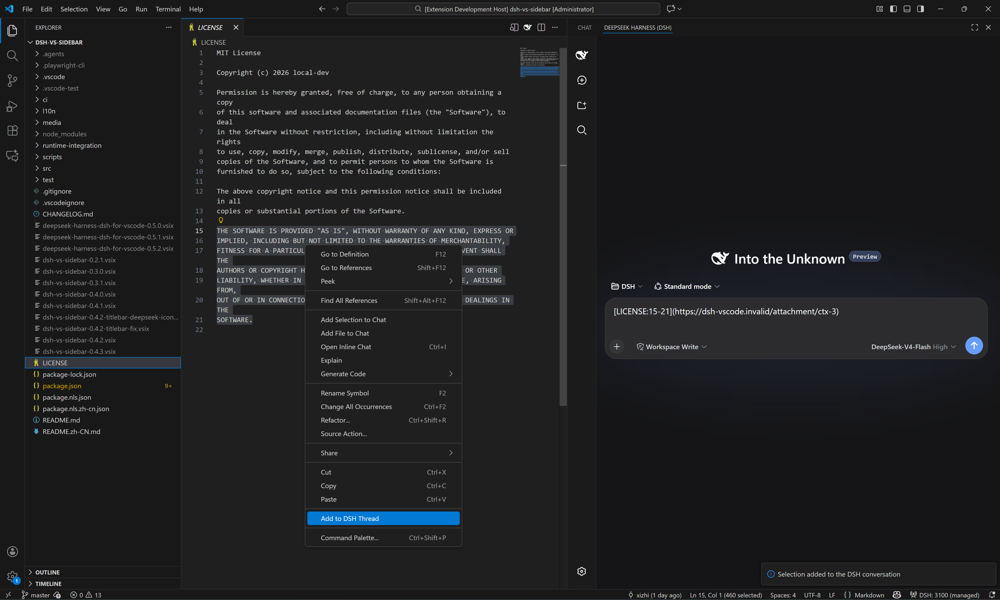

# DeepSeek Harness (DSH) for VS Code

[English](README.md) · [简体中文](README.zh-CN.md)

Embed the DSH web UI in the VS Code auxiliary sidebar, attach editor context, review recorded changes, and use your local DSH session through `@dsh`.

## 1.2.0 candidate status

This is a **1.2.0 candidate**, bundled with integration **0.10.0**. Release validation is incomplete; this candidate has not been published as a 1.2.0 Marketplace release. Installed-VSIX validation is in progress. Final evidence and remaining acceptance items belong in [HANDOFF-1.2.0-VALIDATION.md](HANDOFF-1.2.0-VALIDATION.md).

Passed against the real DSH runtime and browser UI: 60 search cycles across three viewport widths, IME input, prompt/stream/cancel and read/write/edit tool paths, a 601-second steady-state run with reconnects, and ten start/stop cycles. Runtime prompt/tool probes use a deterministic local provider; these checks do not certify every remote provider or optional feature.

The candidate preserves the 1.1.8 watcher and focus fixes, and adds authenticated runtime ports, shared bounded session feeds, confirmed edit attribution, and a browser bridge that separates session navigation from iframe rendering.

## Compatibility

| Item | Requirement |
|---|---|
| VS Code | ≥ 1.106, desktop; remote, virtual and untrusted workspaces are unsupported |
| Target DSH | Exactly `0.2.0-rc.1`; install with `npm i -g @deepseek-ai/dsh@0.2.0-rc.1` |
| Legacy DSH | Exactly `0.1.2-rc.1`, through the separate legacy adapter |
| Node.js for the target child | `^22.19.0 \|\| >=24.0.0`; checks the selected executable, independently of VS Code's Node; override with `dsh.local.nodePath` |
| Integration | `dsh-vscode-integration@0.10.0`, bundled with this candidate |

Other DSH versions are unverified and cannot use the managed integration. An external instance without a verified integration handshake is browser-only: session commands and mutations are unavailable, and the extension does not stop that process.

The target host uses the extension-owned authenticated `/api/vscode/v1` facade. Legacy REST routes belong to the legacy adapter. Authenticated owned children are embedded through a host-side loopback proxy that carries their startup cookie.

## Usage and current limits

1. Press `Ctrl+Alt+B` to connect the sidebar.
2. **Add to DSH Thread** appends compact file/selection/folder/Problems links to the **main Conversation** draft without sending. Close DSH's internal right sidebar first: insertion explicitly refuses while it is expanded. Multi-composer acceptance A07 remains **partial**.
3. Use `@dsh` in VS Code Chat. The target adapter shows generation progress and appends only committed assistant text, because VS Code cannot retract abandoned streamed text. The embedded DSH UI retains native streaming.
4. Review DSH Changes with diff/accept/undo. Confirmed native tool edits are recorded after execution; this view is not a pre-execution approval gate for every DSH tool.

Non-text file/image prompt upload, FIM tab completion and the full optional-feature matrix are **not certified**. Draft link attachment is separate from uploading non-text prompt parts. Ctrl+K/Ctrl+I, LM routing, MCP consumption and terminal/UI bridges remain optional; enabling a setting does not certify target-runtime compatibility.

## Installation

Existing published builds are available from the [Marketplace](https://marketplace.visualstudio.com/items?itemName=Xizhi1024.dsh-vs-sidebar) and [Releases](https://github.com/Xizhi1024/deepseek-harness-dsh-for-vscode/releases). These links do not imply that the 1.2.0 candidate is published. Candidate testing uses a separately built VSIX and isolated VS Code user-data/extensions directories; this development work does not replace a daily installation.

## Configuration

| Key | Default | Description |
|---|---|---|
| `dsh.port` | 3080 | Configured DSH web port |
| `dsh.autoStart` | true | Start an owned service when VS Code opens |
| `dsh.home.mode` | shared | `shared`: official `~/.dsh`; `isolated`: extension-private home |
| `dsh.profile` | vscode | Base profile; the target adds `-dsh020rc1` |
| `dsh.runtime.version` | empty | Optional exact version selection |
| `dsh.executablePath` | empty | Explicit executable, package directory or shim |
| `dsh.closePolicy` | onVscodeExit | Owned-service lifecycle policy |
| `dsh.features.changes-review` | true | Changes review tree |
| `dsh.features.chat-participant` | true | `@dsh` participant |
| `dsh.features.ctrl-k` / `ctrl-i` | false | Optional inline edit commands |
| `dsh.features.lm-route` / `mcp-consume` | false | Optional LM/MCP integration |
| `dsh.features.tab-completion` | false | Uncertified FIM proof of concept |
| `dsh.fim.baseUrl` | empty | Upstream FIM endpoint; key via **DSH: Set FIM API Key** |
| `dsh.keybindings.ctrlL` | false | Attach selection with Ctrl+L |
| `dsh.bridge.terminal` / `editorRead` / `ui` | false | Optional bridge consent switches |

See `package.json` for all settings and **DSH: Diagnose** for runtime details.

### Profile and data scope

For DSH `0.2.0-rc.1`, default profile `vscode` becomes `vscode-dsh020rc1`, separating plugin and patch configuration from legacy. **Profiles do not isolate home-level sessions or credentials**: processes using the same home still share those data. Use an isolated home for independent data. First-time scaffolding can inherit donor module configuration. Restart/stop affects only the extension-owned child.

## License

[MIT](LICENSE)
