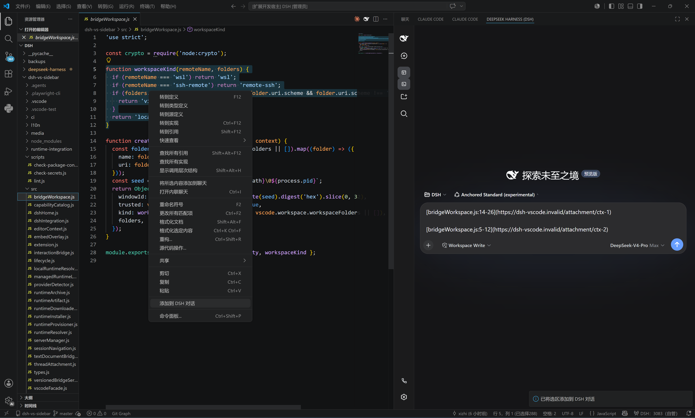

# DeepSeek Harness(dsh) for VS Code

[简体中文](README.zh-CN.md) · [English](README.md)

在 VS Code 辅助侧边栏嵌入完整 DSH Web UI：每个窗口自动启动并持有一个本地 `dsh web` 服务（cwd = 当前工作区），你的模块、技能、MCP、凭据、会话全部可用。扩展还将 VS Code 能力提供给 DSH：

- **侧边栏即对话**：`Ctrl+Alt+B` 打开；复制/粘贴/右键菜单、文件跳转、主题跟随全部原生
- **VS Code 能力**：DSH 可打开工作区文件和 diff、读取诊断及编辑器元数据。终端、编辑器内容读取、界面交互与 MCP 等能力可按需开启。
- **上下文附加**：右键把文件 / 选区 / 文件夹 / Problems 以紧凑链接加入对话草稿，绝不粘贴源码、绝不自动发送

## ⚠️ 兼容性

| 项 | 要求 |
|---|---|
| VS Code | ≥ 1.106，仅桌面版；不支持远程 / 虚拟 / 不受信任工作区 |
| DSH CLI | 自动发现已有安装。默认设置下，macOS、Windows 和 Linux（x64、arm64）缺少 DSH 时会自动安装。 |
| Node.js | 自动安装 DSH 时会附带独立的 Node.js。手动安装 DSH 时，可用 `dsh.local.nodePath` 指定自动发现未找到的 Node.js。 |

## 📦 安装

- **Marketplace（推荐）**：扩展视图搜索 **DeepSeek Harness**（发布者 Xizhi1024），或 `code --install-extension Xizhi1024.dsh-vs-sidebar`
- **VSIX**：从 [Releases](https://github.com/Xizhi1024/deepseek-harness-dsh-for-vscode/releases) 下载 → `Extensions: Install from VSIX...`

启用 `dsh.autoStart` 后，扩展会在 VS Code 启动时检测 DSH。首次安装会将 Node.js 和官方 `@deepseek-ai/dsh` 下载到 VS Code 扩展存储目录，随后启动 `dsh web`。下载失败时可以在侧边栏重试。自动安装的版本可以通过 `dsh.runtime.version` 指定，填写确切的 npm 版本号。

## 🚀 使用

1. 按 `Ctrl+Alt+B` 打开侧边栏——扩展自动启动（或复用）本地 `dsh web` 并加载 UI
2. 编辑器里选中代码 → 右键 **添加到 DSH 对话**，草稿收到 `文件:行号` 紧凑链接，回车发送

常用命令包括打开侧边栏、在浏览器打开、重启或停止服务，以及诊断。

启动失败后，切换编辑器或重新打开侧边栏时会保持暂停。可以点击侧边栏的 **重试**、执行 **重启 DSH 服务**，或修改相关设置后再尝试。

## ⚙️ 配置

| 键 | 默认 | 说明 |
|---|---|---|
| `dsh.port` | 3080 | DSH Web 服务端口 |
| `dsh.autoStart` | true | VS Code 启动即拉起服务 |
| `dsh.home.mode` | shared | shared=共享官方 ~/.dsh；isolated=扩展私有目录 |
| `dsh.profile` | web | DSH profile 目录名 |
| `dsh.executablePath` | (空) | 手动指定 DSH 可执行文件/包目录/shim，优先于自动发现 |
| `dsh.closePolicy` | onVscodeExit | 何时停止自有服务 |
| `dsh.features.mcp-consume` | false | DSH 消费 VS Code 侧 MCP 服务器 |
| `dsh.keybindings.ctrlL` | true | Ctrl+L 把选区加入对话草稿（绝不发送） |
| `dsh.bridge.terminal` / `editorRead` / `ui` | false | 终端 / 编辑器读取 / UI 表面桥（同意开关） |
| `dsh.features.call-export` | false | 允许 DSH 经确认后调用 VS Code 扩展导出的 API |

完整键列表见 `package.json`；诊断用命令 **DSH: Diagnose**。

## License

[MIT](LICENSE)
